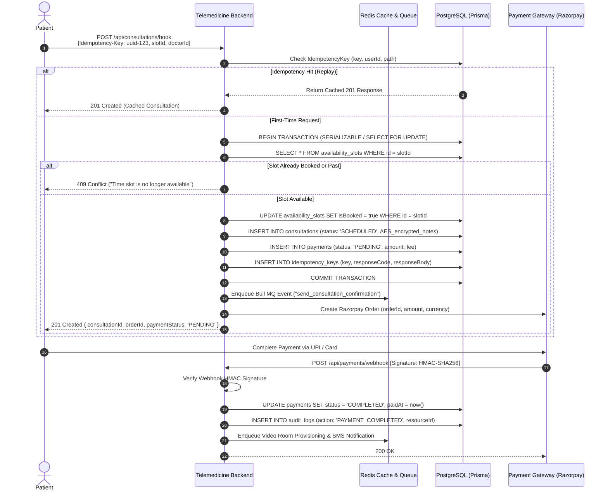
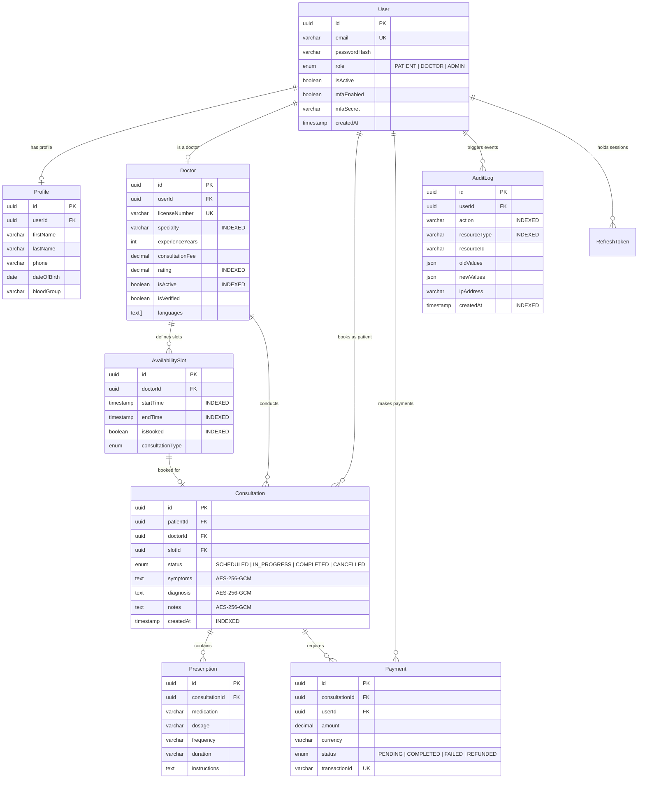

# 🏛️ Amrutam Telemedicine — System Architecture Specification

> **Target Scale:** 100,000 daily consultations · **SLA:** 99.95% Availability · **Latency Budget:** p95 < 200ms reads, < 500ms writes  
> **Classification:** High-Throughput Distributed Ayurvedic Healthcare Platform

---

## 📑 Table of Contents
1. [High-Level Architecture & End-to-End Data Flow](#1-high-level-architecture--end-to-end-data-flow)
2. [Booking Flow Sequence Diagram](#2-booking-flow-sequence-diagram)
3. [Entity-Relationship (ER) Diagram](#3-entity-relationship-er-diagram)
4. [API Architecture & Schema Mapping](#4-api-architecture--schema-mapping)
5. [Retry & Backoff Strategies](#5-retry--backoff-strategies)
6. [Data Partitioning & Scalability Strategy (100k/day)](#6-data-partitioning--scalability-strategy-100kday)
7. [Caching & Concurrency Handling](#7-caching--concurrency-handling)
8. [Transaction Management & Distributed Sagas](#8-transaction-management--distributed-sagas)
9. [Backup & Disaster Recovery (DR) Strategy](#9-backup--disaster-recovery-dr-strategy)

---

## 1. High-Level Architecture & End-to-End Data Flow

The system is designed with a **stateless, horizontally scalable application layer**, an **atomic persistence layer**, and an **asynchronous messaging fabric**.

```
[ Web Clients / Mobile Apps (iOS/Android) ]
                   │
                   │ HTTPS (TLS 1.3)
                   ▼
       [ Cloudflare Edge / WAF ]
          ├── DDoS Shield & IP Reputation
          └── Edge SSL Termination & Gzip/Brotli
                   │
                   ▼
     [ Nginx Reverse Proxy / AWS ALB ]
          ├── SSL Offloading & Path Routing
          └── Health Check Routing (/health, /ready)
                   │
       ┌───────────┴───────────┐
       ▼                       ▼
┌──────────────┐        ┌──────────────┐
│ Express API  │        │ Express API  │ (Auto-scaled Docker containers)
│ Node.js 20   │        │ Node.js 20   │
└──────┬───────┘        └──────┬───────┘
       │                       │
 ┌─────┴───────────────────────┴─────┐
 │ Middleware Processing Pipeline    │
 │  1. Helmet (Security Headers)     │
 │  2. CORS Policy                   │
 │  3. Sliding-Window Rate Limiter   │
 │  4. Trace Context Injector        │
 │  5. Speakeasy TOTP & JWT Auth     │
 │  6. Distributed Idempotency Filter│
 └─────┬───────────────────────┬─────┘
       │                       │
       ▼                       ▼
┌──────────────────┐    ┌──────────────────┐
│ PostgreSQL 15    │    │ Redis 7 Cluster  │
│ Primary (Writes) │    │  - Rate Limits   │
│  ├── Read Replica│    │  - Token Blacklist│
│  └── Read Replica│    │  - Bull MQ Queue │
└──────────────────┘    └─────────┬────────┘
                                  │
                                  ▼
                        ┌──────────────────┐
                        │ Async Workers    │
                        │ (Bull MQ Daemon) │
                        │  - SMS / Email   │
                        │  - Razorpay Webh │
                        │  - Doctor Alerts │
                        └──────────────────┘
```

### Request Lifecycle Pipeline
1. **Edge & Ingress:** Requests hit Cloudflare and the Application Load Balancer (ALB).
2. **Observability & Trace:** The request is stamped with a unique `X-Trace-Id` (UUIDv4) that propagates through all downstream queries and logs.
3. **Security Filter:** `helmet` applies CSP, HSTS, and Frameguard. Rate limiter evaluates the client IP / user identifier via Redis atomic sliding window.
4. **Authentication & RBAC:** Access tokens are verified using HS256 (`JWT_ACCESS_SECRET`). If MFA is enabled on the account, the session requires step-up TOTP verification. Role claims (`PATIENT`, `DOCTOR`, `ADMIN`) are strictly enforced.
5. **Idempotency Gate:** Mutating requests (`POST`, `PUT`, `PATCH`) with an `Idempotency-Key` header check the `idempotency_keys` table. Replays return the cached response immediately without invoking business logic.
6. **Execution & Persistence:** Handlers execute inside Prisma transactions (`$transaction`) with optimistic concurrency checks. Clinical data is encrypted using AES-256-GCM before writing to PostgreSQL.
7. **Observability Emission:** Prometheus duration histograms (`http_request_duration_seconds`) and counters are updated in memory; Pino structured logs are flushed with the trace context.

---

## 2. Booking Flow Sequence Diagram

The consultation booking flow ensures **zero double-booking**, **atomic payment synchronization**, and **idempotency** across network disconnects.



---

## 3. Entity-Relationship (ER) Diagram

The data model uses 8 core relational entities optimized for B-tree index traversal, referential integrity, and HIPAA/DISHA compliance.



---

## 4. API Architecture & Schema Mapping

The API strictly adheres to **RESTful conventions** with typed Zod request/response validation, standard HTTP status codes, and uniform response packaging:

```json
{
  "success": true,
  "data": { ... },
  "message": "Optional human-readable confirmation",
  "meta": { "page": 1, "limit": 10, "total": 124 }
}
```

### Complete Schema Catalog:
| Route | Method | Access | Idempotent | Description |
|---|---|---|---|---|
| `/health` | `GET` | Public | Yes | Liveness probe (uptime, memory, process) |
| `/ready` | `GET` | Public | Yes | Readiness probe (Postgres + Redis checks) |
| `/metrics` | `GET` | Prometheus | Yes | Prometheus format metrics |
| `/api/openapi.json` | `GET` | Public | Yes | Full OpenAPI 3.0 specification |
| `/api/auth/register` | `POST` | Public | No | Patient signup (self-promoted Admin demoted) |
| `/api/auth/login` | `POST` | Public | No | Credential verification & MFA challenge |
| `/api/auth/refresh` | `POST` | Public | No | 7-day token rotation with reuse detection |
| `/api/auth/mfa/setup` | `POST` | Protected | Yes | Generates Speakeasy TOTP secret & QR |
| `/api/auth/mfa/enable` | `POST` | Protected | Yes | Confirms 6-digit TOTP code and locks MFA |
| `/api/doctors` | `GET` | Public | Yes | Filter by specialty, fee, rating, language |
| `/api/doctors/:id/slots` | `GET` | Public | Yes | Available booking slots for doctor |
| `/api/consultations` | `POST` | Patient | **Yes (Key)** | Books appointment atomically |
| `/api/consultations/:id/prescriptions`| `POST` | Doctor | Yes | Issues structured Ayurvedic Rx |
| `/api/payments` | `POST` | Patient | **Yes (Key)** | Initiates Razorpay transaction |
| `/api/admin/analytics` | `GET` | Admin | Yes | Daily consults, revenue, completion rate |
| `/api/admin/audit-logs` | `GET` | Admin | Yes | Security audit trail with pagination |

---

## 5. Retry & Backoff Strategies

To prevent **thundering herd** and **cascading failures** across distributed dependencies (Razorpay, Speakeasy, SMS/Email delivery):

### 1. Truncated Exponential Backoff with Jitter
For network calls to external gateways, the retry interval $t_i$ for attempt $i$ is calculated as:
$$t_i = \min(t_{\max},\; t_{\text{base}} \times 2^i) \pm \text{random\_jitter}$$

- **Base interval ($t_{\text{base}}$):** 200ms
- **Maximum interval ($t_{\max}$):** 5,000ms
- **Max retries:** 3 attempts
- **Full Jitter formula:** `sleep = uniform(0, min(cap, base * 2 ** attempt))`

### 2. Circuit Breaker Configuration (Opossum)
- **Threshold:** 50% failure rate over a 10-second rolling window.
- **Trip State:** Circuit opens for 15 seconds; requests fail fast with `503 Service Unavailable` rather than timing out and consuming socket pool threads.
- **Half-Open Probe:** Single test probe sent after 15 seconds; if successful, circuit resets to Closed.

---

## 6. Data Partitioning & Scalability Strategy (100k/day)

### Workload Calculations for 100,000 Consultations / Day:
- **Daily Writes:**
  - 100k consultations + 100k payments + 100k prescriptions + 400k audit logs = **~700,000 write ops/day**.
  - Average write throughput: **~8.1 writes/sec**; Peak write throughput (4x surge): **~32.4 writes/sec**.
- **Daily Reads:**
  - Doctor search, slot discovery, history = **~1,500,000 read ops/day** (~17.3 reads/sec; peak ~70 reads/sec).
- **Data Volume Growth:**
  - ~1.2 GB raw relational data / month; ~14.4 GB / year.

### Partitioning Scheme
1. **Range Partitioning by Month on `audit_logs` & `consultations`:**
   ```sql
   CREATE TABLE audit_logs (
       id UUID NOT NULL,
       created_at TIMESTAMP NOT NULL,
       ...
   ) PARTITION BY RANGE (created_at);

   CREATE TABLE audit_logs_y2026m10 PARTITION OF audit_logs
       FOR VALUES FROM ('2026-10-01') TO ('2026-11-01');
   ```
   *Benefit:* Enables instant partition pruning during admin date-range queries and zero-downtime rolling archiving (`DETACH PARTITION`).
2. **Read Replica Routing:**
   - Write operations (`INSERT`, `UPDATE`, `DELETE`) route to the Primary PostgreSQL instance.
   - Read-heavy queries (`GET /api/doctors`, `GET /api/doctors/:id/slots`) route to 2 asynchronous Read Replicas with `max_standby_streaming_delay = 3s`.
3. **Database Indexing:**
   - Composite B-Tree indexes on `(doctorId, startTime, endTime)` for microsecond slot lookup.
   - Partial index on `availability_slots WHERE isBooked = false` reducing index tree height by 80%.

---

## 7. Caching & Concurrency Handling

### 1. Redis Cache-Aside Pattern
- **Doctor Directory Cache:** Key `cache:doctors:spec:{specialty}:page:{p}` with 300s TTL. Invalidation triggered on doctor profile/rating update.
- **Availability Slots:** Key `cache:slots:doc:{doctorId}:date:{yyyy-mm-dd}` with 60s TTL. Evicted immediately when a booking is confirmed.
- **User Session & Role:** Cached in Redis with 15-minute TTL matching access token lifetime.

### 2. Concurrency & Race-Condition Guarding
To prevent the **classic double-booking vulnerability** when two patients click "Book" simultaneously on the same doctor slot:
1. **Database Constraint:** `slotId` has a `UNIQUE` foreign-key constraint in `consultations`.
2. **Row-Level Locking:** During booking checkout:
   ```typescript
   await prisma.$transaction(async (tx) => {
     // Row is locked for update preventing concurrent thread access
     const slot = await tx.$queryRaw`
       SELECT * FROM availability_slots WHERE id = ${slotId}::uuid FOR UPDATE
     `;
     if (slot[0].isBooked) throw new ConflictError('Slot already booked');
     await tx.availabilitySlot.update({ where: { id: slotId }, data: { isBooked: true } });
     return tx.consultation.create({ ... });
   });
   ```

---

## 8. Transaction Management & Distributed Sagas

The telemedicine system uses an **Orchestration Saga** managed by Bull MQ workers for multi-service consistency:

```
[ Saga Orchestrator ]
  ├── Step 1: Reserve Slot & Create Pending Consultation (PostgreSQL ACID)
  ├── Step 2: Charge Payment / Authorize Razorpay Transaction
  │     ├── On Success ──► Step 3: Transition Consultation to 'SCHEDULED'
  │     └── On Failure ──► Compensating Tx: Revert Slot 'isBooked' = false
  └── Step 4: Dispatch Confirmation Notifications (Email / SMS)
```

- **Compensating Transactions:** If payment authorization fails or the patient cancels within the 10-minute hold window, the orchestrator triggers an atomic compensating action that unlocks the slot and marks the consultation `CANCELLED`.
- **At-Least-Once Delivery:** Handlers are designed to be idempotent using the `IdempotencyKey` table and deduplication checks.

---

## 9. Backup & Disaster Recovery (DR) Strategy

| Metric | Target SLA | Implementation |
|---|---|---|
| **RPO (Recovery Point Objective)** | **< 5 minutes** | Continuous PostgreSQL Write-Ahead Log (WAL) archiving to encrypted AWS S3 buckets |
| **RTO (Recovery Time Objective)** | **< 15 minutes** | Automated multi-AZ container failover via ECS/K8s + RDS Multi-AZ Standby |
| **Data Redundancy** | 99.999999999% (11 9's) | S3 Cross-Region Replication (primary: `ap-south-1` Mumbai, secondary: `ap-southeast-1` Singapore) |

### Backup Automation:
1. **Daily Full Snapshots:** Automated daily snapshot executed at 02:00 IST with 30-day retention.
2. **Continuous WAL Archiving:** Point-In-Time-Recovery (PITR) enabled up to 35 days, allowing restoration to any exact second.
3. **Disaster Simulation Drill:** Automated monthly DR drill spinning up the secondary region stack from the latest snapshot and executing Playwright synthetic verification suites.
